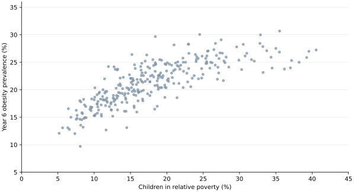
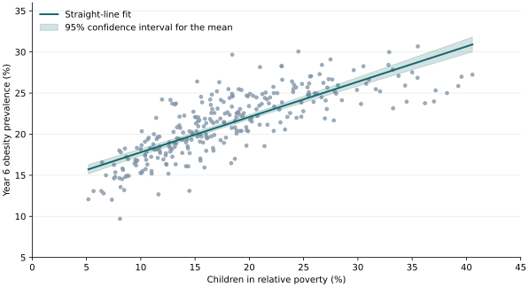

## Research question {#research-question}

In 2024/25, across English local authorities, is a higher child poverty
rate associated with higher Year 6 obesity prevalence?

We expect a positive association. In the straight-line model, the null
hypothesis is a zero slope and the alternative is a positive slope.

## Literature review {#literature}

## Datasets {#data}

- Year 6 obesity prevalence, including severe obesity, among children
  aged 10–11 in academic year 2024/25.
  [OHID Fingertips, indicator 90323](https://fingertips.phe.org.uk/profile/obesity-physical-activity-nutrition/)
- Percentage of children under 16 living in relative low-income families
  before housing costs, financial year ending March 2025.
  [ONS Explore Local Statistics, using DWP data](https://www.ons.gov.uk/explore-local-statistics/indicators/children-in-relative-poverty-before-housing)

We matched 296 lower-tier local authorities by official area code. The
City of London and Isles of Scilly had no obesity figure. We used the
294 councils with both measures. The reporting periods overlap and the
two measures use different age groups.

## Exploratory analysis {#exploration}

The scatterplot showed a positive overall association.

## Statistical methods {#methods}

We calculated Pearson's correlation and fitted an ordinary least squares
regression with Year 6 obesity prevalence as the outcome and child
poverty as the predictor. The shaded area shows the 95% confidence
interval for the mean fitted obesity prevalence.

## Results {#results}

| Measure | Estimate |
|---|---|
| Pearson correlation | 0.79 |
| Obesity difference per 10 percentage points higher poverty | +4.29 percentage points (95% CI 3.91 to 4.67) |
| R² | 0.63 |
| Residual standard deviation | 2.43 percentage points |
| Residual variance | 5.93 squared percentage points |

## Evaluation {#evaluation}

## Further research {#further-research}

- Compare the estimate before and after accounting for region.
- Check which councils and measures are comparable in 2022 and 2025, then
  examine whether changes in poverty and obesity move together.

## References {#references}

- Ernest, D.K. et al. (2025) ‘A scoping review of the social determinants
  of pediatric and adolescent obesity’, *International Journal of
  Pediatrics*, 2025, 8871022. [DOI](https://doi.org/10.1155/ijpe/8871022)
- Office for Health Improvement and Disparities (2025) *National Child
  Measurement Programme annual report, academic year 2024 to 2025,
  England*. [Report](https://www.gov.uk/government/statistics/national-child-measurement-programme-ncmp-annual-report-academic-year-2024-to-2025-england)
- Office for Health Improvement and Disparities, *Fingertips*.
  [Indicator 90323](https://fingertips.phe.org.uk/profile/obesity-physical-activity-nutrition/)
- Office for National Statistics, *Explore Local Statistics*.
  [Child poverty indicator](https://www.ons.gov.uk/explore-local-statistics/indicators/children-in-relative-poverty-before-housing)
